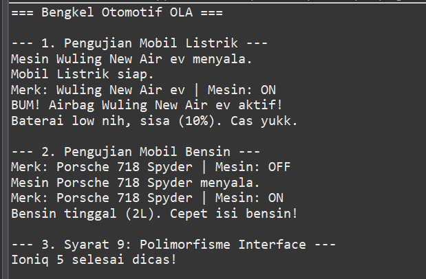
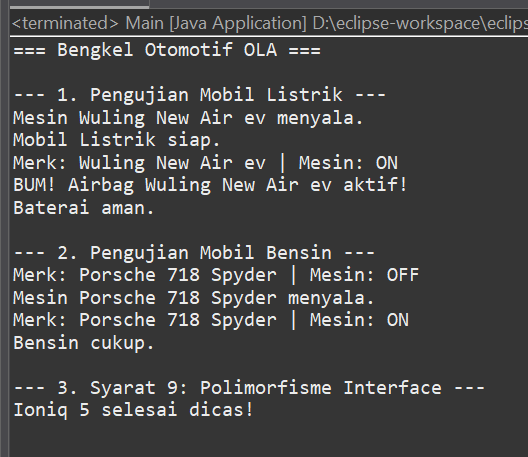

Identitas Mahasiswa
- Nama: Nova Chauliyatul Faizah
- NIM: H1D025019
- Shift awal: C
- Shift akhir: H-I
- Tema: Otomotif (Digit terakhir 9)

Petunjuk Compile dan Run
Pastikan perangkat udah install Java Development Kit (JDK). Buka CMD di tempat file Java disimpan, lalu jalankan perintah berikut:
1. compile semua file Java sekaligus dengan: javac *.java
2. jalankan: java Main

